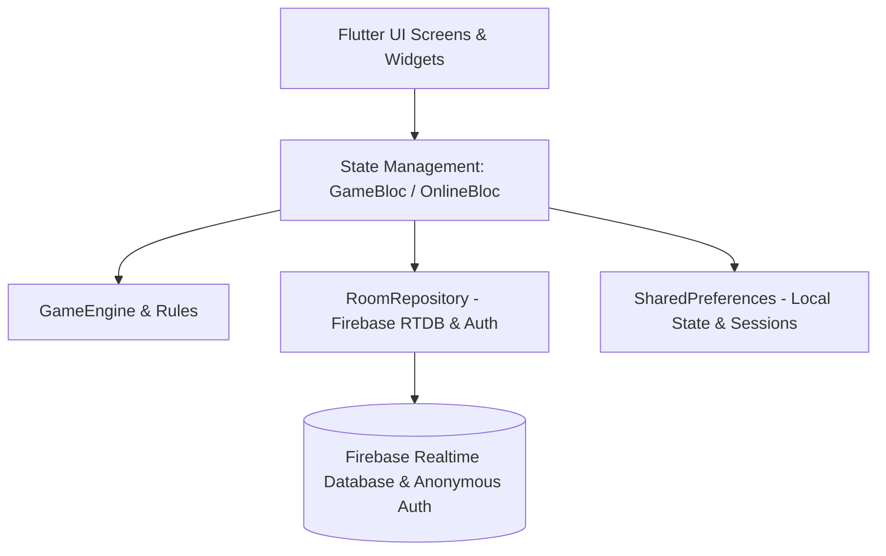
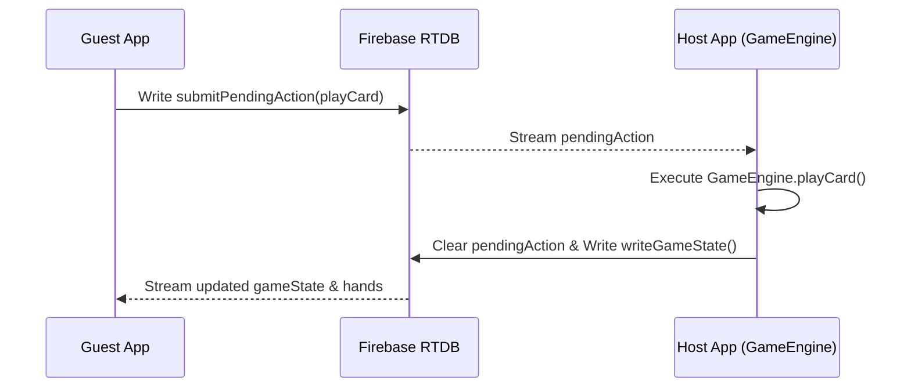
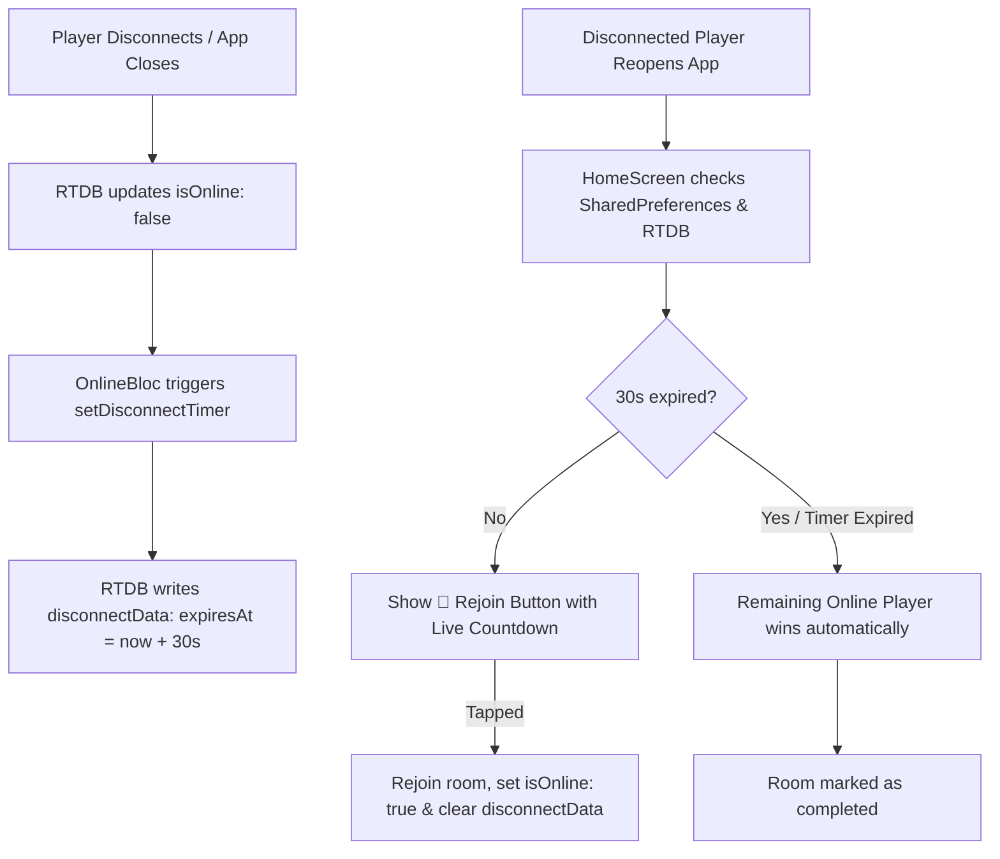

# GadhaBaazi - Technical Architecture & Documentation

Welcome to the technical documentation for **GadhaBaazi**, a classic Indian multiplayer card game (Donkey/Get Away) built using **Flutter**, **BLoC (Business Logic Component)** state management, and **Firebase Realtime Database (RTDB)**.

---

## 🏛 1. High-Level Architecture Overview

The app follows a clean, decoupled architecture separating **Game Rules & Engine**, **State Management (BLoC)**, **Database/Network Services**, and **UI Presentation**:



### Core Architecture Layers:
1. **Engine Layer (`lib/engine/`)**: Pure Dart game engine without Flutter or Firebase dependencies. Enforces turn rules, suit following, punishment handling, unending loop resolution, and loser/donkey calculation.
2. **Service Layer (`lib/services/`)**: `RoomRepository` handles all Firebase RTDB real-time streams, room generation, pending actions, and disconnect timer lifecycle.
3. **State Management (`lib/blocs/`)**: BLoCs (`GameBloc` for local play, `OnlineBloc` for online multiplayer) translate user actions into engine invocations and database updates.
4. **UI Layer (`lib/screens/`, `lib/widgets/`)**: Responsive Flutter screens featuring custom animations, suit indicators, categorized card hands, and toast feedback.

---

## 🎴 2. Core Game Rules & Engine Mechanics (`lib/engine/`)

### A. Deck & Dealing (`deck_builder.dart`, `game_engine.dart`)
- A standard 52-card deck is created and shuffled using `Random.secure()`.
- Cards are distributed sequentially among players.
- **First Turn Rule**: The player holding the **Ace of Spades (♠A)** *must* play it first to lead the first round.

### B. Round Structure & Suit Following (`rules/move_rules.dart`)
- The lead player sets the **round suit**.
- All subsequent players must play a card of the **same suit** if they have one in their hand.
- If a player owns matching suit cards but attempts to play a different suit, the move is flagged as `invalidMove`.

### C. Punishment Mechanism (`rules/punishment_rules.dart`)
When a player **does not have any cards of the round suit**:
1. They **must give a punishment card** (any card from their hand) to the player who played the highest card of the round suit so far.
2. **Card Recovery**: All cards played on the table during that round are **returned back to their original players' hands**.
3. The punishment card is added to the target player's hand.
4. The player who gave the punishment card leads the next round.

### D. Unending Loop Detection & Card Redistribution
In 2-player games, players can enter an infinite loop of trading cards back and forth without finishing hands.
- **Detection**: Track total card count across rounds. If the total active cards in play are **less than or equal to 4** (`totalCards <= 4`), and this total remains constant for 3 consecutive rounds, `unendingLoopDetected` is set to `true`.
- **Redistribution Logic (`distributeNewCards`)**:
  - Collects cards strictly from **normal completed rounds** (excluding punishment rounds).
  - Filters out any card **currently held in any active player's hand**.
  - Shuffles the remaining distinct discard pool and deals up to 5 new cards to each player, resolving the loop safely without card duplication.
- **Automation**: In online mode, redistribution is fully automated by the host once a loop is detected, showing a global alert toast to all players.

### E. Game Over & Donkey Determination (`rules/loser_rules.dart`)
- When a player empties their hand, they finish the game and rank safely.
- The **last remaining player** with cards in hand is declared the **Donkey** ("Gadha").

---

## 🌐 3. Online Multiplayer Architecture (`lib/blocs/online/`, `lib/services/`)

Online gameplay uses a **Host-Authoritative Client-Server Architecture over Firebase RTDB**:



### Key Components:
- **Host Role**: The player who created the room runs the local `GameEngine`. Host validates guest moves, handles turn transitions, and syncs game state to RTDB.
- **Guest Role**: Guests listen to `/rooms/$roomId/gameState` and their private hand stream `/rooms/$roomId/hands/$uid/cards`. Moves are submitted via `/rooms/$roomId/pendingAction`.
- **Host Migration**: If the current host disconnects, the next active online player in join order automatically claims host leadership (`claimHost`).
- **Round Transitions**: Fully automated. Once a round completes, a 2-second timer triggers the host to auto-start the next round, removing any manual "Next Round" buttons.
- **Punishments Notification**: When player X punishes player Y, a global announcement notification is shown to all players in the room (hiding the specific card detail from third-party players).

---

## ⚡️ 4. Disconnect, 30-Second Timer & Rejoin System

To prevent games from stalling when a player drops connection or closes their app:



### Detailed Flow:
1. **Presence Monitoring**: Firebase `onDisconnect()` marks `isOnline: false` on the player node when connection breaks.
2. **Disconnect Data**: `setDisconnectTimer` writes a `disconnectData` node under the room:
   ```json
   {
     "disconnectedUid": "user123",
     "disconnectedName": "Rahul",
     "disconnectedAt": 1721640000000,
     "expiresAt": 1721640030000
   }
   ```
3. **Home Screen Ticker**: On app launch, `HomeScreen` inspects local `SharedPreferences` for active sessions. If `expiresAt` is in the future, it renders a dynamic **"Rejoin Room (XX s remaining)"** button with a 1-second countdown ticker.
4. **Auto-Win Enforcement**: If 30 seconds pass without a rejoin, the active player's `OnlineBloc` automatically ends the game, declaring the remaining player the winner.

---

## 🗄 5. Firebase Realtime Database (RTDB) Schema

```
/
├── roomCodes/
│   └── {ROOM_CODE} : "{ROOM_ID}"           // Quick code lookup (e.g. "A7K9X2": "-N123456")
│
└── rooms/
    └── {ROOM_ID}/
        ├── meta/
        │   ├── roomId: string
        │   ├── roomCode: string
        │   ├── hostId: string
        │   ├── status: "waiting" | "in_progress" | "completed"
        │   ├── maxPlayers: number
        │   └── createdAt: number
        │
        ├── players/
        │   └── {UID}/
        │       ├── uid: string
        │       ├── name: string
        │       ├── isOnline: boolean
        │       └── joinedAt: number
        │
        ├── gameState/                      // Public synchronized engine state
        │   ├── phase: string
        │   ├── activePlayerIndex: number
        │   ├── playerOrder: string[]
        │   ├── currentRound: { ... }
        │   ├── completedRounds: [ ... ]
        │   └── unendingLoopDetected: boolean
        │
        ├── hands/
        │   └── {UID}/
        │       └── cards: [ { suit, rank }, ... ] // Private hand per user
        │
        ├── pendingAction/                  // Guest move queue
        │   ├── playerId: string
        │   ├── type: "playCard" | "givePunishment"
        │   ├── cardSuit: string
        │   └── cardRank: string
        │
        └── disconnectData/                 // 30s Disconnect timer data
            ├── disconnectedUid: string
            ├── disconnectedName: string
            ├── disconnectedAt: number
            └── expiresAt: number
```

---

## 🖥 6. UI & Screen Structure (`lib/screens/`)

1. **`HomeScreen` (`screens/home/home_screen.dart`)**:
   - Main entry point.
   - Resume offline game option.
   - **Rejoin online game option with real-time 30s countdown timer**.
   - Navigation to Offline Game & Online Mode.
2. **`OnlineModeScreen` (`screens/online/online_mode_screen.dart`)**:
   - Host option (Create Room: select max players).
   - Guest option (Join Room: enter 6-character room code).
3. **`WaitingRoomScreen` (`screens/online/waiting_room_screen.dart`)**:
   - Real-time player list lobby.
   - Displays room code and share option.
   - Host "Start Game" trigger.
4. **`OnlineGameScreen` (`screens/online/online_game_screen.dart`)**:
   - Synchronized game table (`TableCenterWidget`).
   - Categorized hand viewer (`CategorizedHandWidget`).
   - Turn indicator pill, suit badges, and punishment toast notifications.
5. **`GameResultScreen` (`screens/result/game_result_screen.dart`)**:
   - Trophy celebration for winners.
   - Donkey announcement banner and finishing rank list.

---

## 🛠 7. Local Project Files Map

| Path | Purpose |
| :--- | :--- |
| [`lib/engine/game_engine.dart`](file:///Users/shadowwolf/Development/Flutter-Series/gadhabaazi/lib/engine/game_engine.dart) | Core game rules, card plays, punishment handling & loop resolution |
| [`lib/services/room_repository.dart`](file:///Users/shadowwolf/Development/Flutter-Series/gadhabaazi/lib/services/room_repository.dart) | Firebase Auth, RTDB room operations, disconnect timers & presence |
| [`lib/blocs/online/online_bloc.dart`](file:///Users/shadowwolf/Development/Flutter-Series/gadhabaazi/lib/blocs/online/online_bloc.dart) | Host/Guest online game state machine, streams, auto-win enforcement |
| [`lib/blocs/game/game_bloc.dart`](file:///Users/shadowwolf/Development/Flutter-Series/gadhabaazi/lib/blocs/game/game_bloc.dart) | Offline game state management & local game save persistence |
| [`lib/screens/home/home_screen.dart`](file:///Users/shadowwolf/Development/Flutter-Series/gadhabaazi/lib/screens/home/home_screen.dart) | Home dashboard & active online session rejoin countdown button |
| [`lib/screens/online/online_game_screen.dart`](file:///Users/shadowwolf/Development/Flutter-Series/gadhabaazi/lib/screens/online/online_game_screen.dart) | Main online interactive table & hand view |
| [`lib/widgets/categorized_hand_widget.dart`](file:///Users/shadowwolf/Development/Flutter-Series/gadhabaazi/lib/widgets/categorized_hand_widget.dart) | Suit-sorted card hand UI component |
